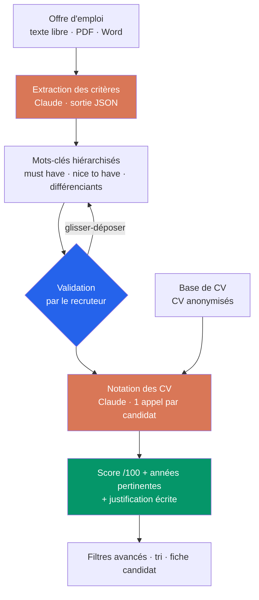

# 🎯 Tribara

> **Trier 300 candidatures en quelques minutes, sans passer à côté des bons profils.**
> Le recruteur décrit le poste en langage naturel, valide les mots-clés extraits,
> et chaque CV est noté avec une justification lisible — pas un score opaque.


Projet de fin d'études — **ECE Paris**.

---

## Le problème

Un chargé de recrutement passe **80 % de son temps à trier des candidatures**. Sur une
offre classique, c'est **~300 candidatures reçues, dont 70 % hors sujet** — jusqu'à
15 heures par semaine sur une tâche à faible valeur ajoutée.

Les ATS du marché (Applicant Tracking Systems) savent publier les offres et centraliser
les candidats, mais leur tri automatique déçoit. Nous avons interrogé **20 acteurs du
recrutement** :

| Constat | Part |
|---|---|
| Trouvent leurs outils insuffisants face à leurs besoins réels | **70 %** |
| Estiment le scoring automatique **peu fiable** | **80 %** |

Trois priorités ressortent : **rapidité, pertinence, simplicité**.

Le défaut commun des outils existants : ils **repèrent des mots-clés sans lire le
contexte**. Un CV où « Python » apparaît dans la liste de loisirs pèse autant qu'un CV
où il structure trois ans d'expérience. Ni l'ordre, ni la récence, ni l'importance
relative des informations ne sont pris en compte — alors les recruteurs repassent
derrière l'outil, et le gain de temps disparaît.

## L'approche

Plutôt qu'un score opaque calculé sur des fréquences de mots, Tribara fait lire le CV et
l'offre par un LLM, et lui demande **une note *plus* une justification** — que le
recruteur peut contredire.



**L'étape de validation est le cœur du produit.** Aucun outil ne devine parfaitement ce
qu'un recruteur a en tête : Tribara propose une hiérarchisation, le recruteur la corrige
en dix secondes, et la notation part sur *ses* critères plutôt que sur une extraction
approximative.

## Ce qui tourne aujourd'hui

- ✅ **Parcours complet en trois étapes** — description du poste → validation des
  mots-clés → résultats classés
- ✅ **Extraction des critères** depuis du texte libre, un métier, un secteur, une
  localisation, ou une fiche de poste déposée en **PDF / Word** (texte extrait dans le
  navigateur, sans upload)
- ✅ **Hiérarchisation en trois niveaux** — indispensables, appréciés, différenciants,
  réorganisables par **glisser-déposer** (dnd-kit), avec ajout et suppression
- ✅ **Notation par candidat** — score /100, années d'expérience **pertinentes pour ce
  poste** (et non le total de carrière), et justification factuelle en français
- ✅ **Résultats progressifs** — les 3 premiers profils s'affichent d'abord, le reste
  arrive au fil de l'eau plutôt que derrière un écran de chargement
- ✅ **Filtres avancés** — conditions combinables sur compétences, expérience, formation
  et localisation, plus le tri par score
- ✅ **Anonymisation côté serveur** — le modèle ne reçoit jamais nom, email, téléphone
  ni LinkedIn

## Le parti pris sur les biais

Le recrutement assisté par IA a un problème documenté de biais algorithmique. Deux
garde-fous sont implémentés :

**Le modèle ne voit pas l'identité du candidat.** `app/api/score-resume/route.ts` retire
nom, email, téléphone, LinkedIn et photo avant l'appel. Il ne reste que l'intitulé, le
résumé, la localisation, les formations, les expériences et les compétences — le prompt
système interdit en plus tout commentaire sur l'identité, l'âge, le genre ou l'origine
supposés.

**Chaque score est justifié.** Une note sans explication ne peut pas être contestée. Ici
chaque candidat arrive avec deux ou trois phrases disant ce qui correspond et ce qui
manque, adossées au contenu du CV — le recruteur garde la décision.

## Stack

| | |
|---|---|
| **Interface** | Next.js 15 (App Router), React 18, TypeScript, Tailwind CSS, shadcn/ui (Radix) |
| **IA** | `@anthropic-ai/sdk` — Claude Opus 4.8, sorties structurées JSON schema |
| **Interactions** | dnd-kit (glisser-déposer), framer-motion (transitions) |
| **Lecture de fichiers** | pdfjs-dist et mammoth, exécutés côté navigateur |
| **Parsing de CV** *(hors-ligne)* | Python, Tesseract OCR, pdf2image, OpenCV |

Toute la logique serveur tient dans deux route handlers Next.js : il n'y a ni base de
données, ni backend séparé à déployer.

## Démarrage

```bash
git clone https://github.com/Aminebousmah/Tribara.git
cd Tribara
npm install

cp .env.example .env.local     # puis renseigner ANTHROPIC_API_KEY
npm run dev                    # http://localhost:3000/search
```

Une clé API Anthropic est nécessaire ([console.anthropic.com](https://console.anthropic.com/settings/keys)).
Elle n'est lue que dans `app/api/**`, côté serveur, et n'est jamais exposée au navigateur.

```bash
npm run build      # build de production
npx tsc --noEmit   # typecheck
npm run lint       # ESLint
```

## Structure

```
app/
  api/generate-keywords/   offre d'emploi → mots-clés hiérarchisés
  api/score-resume/        CV + poste → score, années pertinentes, justification
  search/page.tsx          orchestration des trois étapes
components/search/         StepContent · StepValidation · StepResults · filtres
lib/
  anthropic.ts             client Claude, helper de sortie JSON, mapping d'erreurs
  api.ts                   wrappers fetch côté client
public/
  candidates.json          11 CV de démonstration (identités fictives)
  types.ts                 ParsedJob, ResumeScore, Candidate, filtres
scripts/parse_resume.py    parseur de CV OCR hors-ligne (a servi à bâtir le jeu de données)
```

## Feuille de route

- [x] Extraction des critères depuis une offre d'emploi
- [x] Validation et hiérarchisation des mots-clés par le recruteur
- [x] Notation des CV avec justification, filtres et tri
- [x] Migration de la couche IA vers l'API Anthropic (backend Python retiré)
- [ ] Intégration ATS via API et webhook — le candidat est repositionné automatiquement
      dans le pipeline à la réception du score
- [ ] Connecteur **Flatchr**, puis les autres ATS du marché
- [ ] Traitement en continu : chaque nouvelle candidature évaluée à l'arrivée
- [ ] Détection des soft skills et correspondance avec les valeurs de l'entreprise
- [ ] Conformité RGPD de bout en bout et hébergement européen

## Le marché

Le recrutement français pèse **43 Md€**, dont **4,2 Md€** de logiciels et services RH
(Xerfi, Apec). Les ATS existants vont de **50 €/mois** (Flatchr, entrée de gamme) à
**10 000 USD/an** (SmartRecruiters), et le tri fiable reste le maillon faible chez tous.

L'enjeu dépasse le temps gagné : **36 % de turn-over la première année**, et **30 % des
employés partent dans les six premiers mois** — un mauvais tri coûte bien plus cher que
les heures qu'il fait perdre.

Cibles : startups, PME, cabinets de recrutement, grands comptes.

## L'équipe

Projet de fin d'études mené à sept — ECE Paris.

| | |
|---|---|
| **Marie Leclercq** | Gestion de projet · Analyse de données · Machine learning |
| **Ilian Mouhoubi-Duhamel** | Machine learning · NLP |
| **Hugo Scatena** | API · Communication · Gestion de projet |
| **Amine Bousmah** | Bases de données · Parsing |
| **Valentin Soty** | Gestion de projet · Bases de données |
| **Alexandre Blion** | Développement logiciel · UI/UX |
| **Matéo Cocq** | Analyse de données · UI/UX |

## Notes

**Les données de démonstration sont fictives.** Les 11 profils de `public/candidates.json`
ont des noms, emails, téléphones et profils LinkedIn inventés ; seuls compétences et
parcours ont été conservés pour rendre la démo réaliste. Aucune donnée personnelle réelle
n'est versionnée, et les dossiers `CV/` et `out/` sont ignorés par Git.

**Tribara assiste le tri, il ne décide pas.** Les scores servent à prioriser une pile de
CV, pas à écarter automatiquement un candidat.

Sources chiffrées : PwC (2022), Harvard Business Review (2021), Verified Market Reports
(2024), Xerfi, Apec, et notre étude terrain auprès de 20 acteurs du recrutement.

## Licence

MIT
